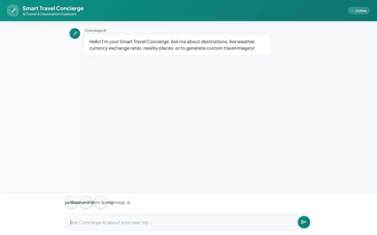

# ✈️ Smart Travel Concierge

A conversational AI travel concierge powered by **Google ADK (Agent Development Kit)** and **Gemini 2.5 Flash**. Smart Travel Concierge helps travelers plan personalized trips, look up destination catalogs, fetch live weather and currency exchange rates, remember dietary preferences, and generate rich travel visuals and video previews.



---

## 🌟 Capabilities & Architecture

Smart Travel Concierge integrates with Google Cloud services and live travel APIs:

### 🧠 Memory & Preference Tracking
- **Vertex AI Memory Bank Service**: Permanently remembers user dietary restrictions, food allergies, and travel preferences across chat sessions using `load_memory` and `preload_memory` tools.

### 🗄️ Database & Catalog
- **Google Cloud Firestore**: Serves as the central destination catalog (`destinations` collection). Enables searching destinations by category (`Culture & Urban`, `Romance & Art`, `Beach & Wellness`), fetching full landmark details, and adding custom destinations dynamically.

### 🎨 Visual & Video Generation
- **Vertex AI Image Generation**: Uses `gemini-3.1-flash-lite-image` in the `global` region to generate high-resolution destination photographs on demand.
- **Vertex AI Omni Video Generation**: Uses `gemini-omni-flash-preview` in the `global` region to generate short video snippets for landmarks and travel destinations.
- **Google Cloud Storage (GCS)**: Stores generated images and videos in a public media bucket and returns permanent, public `https://storage.googleapis.com/...` URLs.

### 🖼️ Rich UI Rendering (A2UI v0.8)
- **A2UI Schema Manager (v0.8)**: Generates structured, responsive UI cards (destinations, weather cards, images, and travel summaries) rendered directly in the chat interface via an `after_model_callback`.

### 💻 Code Execution & Live Tools
- **Agent Engine Sandbox Code Executor**: Runs isolated Python code for travel math, budget breakdowns, and currency conversions.
- **Open-Meteo Live Weather API**: Fetches real-time weather forecasts and temperature readings for cities worldwide.
- **Exchange Rates API**: Fetches live foreign currency exchange rates for travel budget calculations.
- **Google Geocoding & Places APIs (New)**: Converts street addresses to geographic coordinates (`geocode_address`) and discovers nearby tourist attractions, restaurants, and hotels (`find_nearby_places`).

---

## 📋 Implementation Status

| Feature | Status | Notes / Technologies |
| :--- | :---: | :--- |
| **Dietary & Allergy Memory** | ✅ Implemented | Vertex AI Memory Bank (`VertexAiMemoryBankService`) |
| **Destination Catalog Lookup** | ✅ Implemented | Firestore Database (`destinations` collection) |
| **Live Weather Forecasts** | ✅ Implemented | Open-Meteo Live API |
| **Currency Exchange Rates** | ✅ Implemented | Exchange Rates API |
| **Geocoding & Places Search** | ✅ Implemented | Google Maps Geocoding & Places APIs |
| **Destination Image Generation** | ✅ Implemented | `gemini-3.1-flash-lite-image` + GCS |
| **Destination Video Generation** | ✅ Implemented | `gemini-omni-flash-preview` + GCS |
| **Structured A2UI Cards** | ✅ Implemented | A2UI v0.8 Basic Catalog |
| **Python Code Execution** | ✅ Implemented | `AgentEngineSandboxCodeExecutor` |
| **Real-time Flight Search API** | ⏳ Planned | *Planned, not yet implemented* |
| **Hotel Reservation API** | ⏳ Planned | *Planned, not yet implemented* |

---

## 🚀 Local Development & Running the App

### Prerequisites
- **Python 3.12+**
- **Node.js 18+** (for frontend development and demo recording)
- **Google Cloud SDK (`gcloud`)** with Application Default Credentials (ADC) configured.

### 1. Environment Setup

1. Clone the repository and navigate to the project directory:
   ```bash
   cd smart-travel-concierge
   ```

2. Install Python dependencies using `uv` or `pip`:
   ```bash
   uv sync
   ```

3. Configure environment variables in a `.env` file:
   ```bash
   GOOGLE_MAPS_API_KEY=your_google_maps_api_key
   EXCHANGE_RATE_API_KEY=your_exchange_rate_api_key  # Optional
   ```

### 2. Running the Agent Locally

To start the agent in local interactive playground mode:

```bash
agents-cli playground
```

### 3. Running the Web Frontend

To launch the FastAPI proxy server and branded chat UI locally:

```bash
cd frontend
pip install -r requirements.txt
python main.py
```

The server starts locally on port `8080`.

---

## 🎥 Recording Demo Videos

To record a Playwright screen-capture video of the agent UI:

```bash
node .agents/skills/record-demo/record-agent.js \
  -q "What destinations do you recommend in Japan, and what's the weather and currency exchange rate for Tokyo?" \
  -q "Generate a vibrant travel image of cherry blossoms with Mt. Fuji for Kyoto!" \
  --wait 35000 \
  --title "Smart Travel Concierge" \
  -o agent_demo.webm
```

---

## 🛠️ Project Structure

```
smart-travel-concierge/
├── app/
│   ├── agent.py               # Root agent definition & A2UI callback setup
│   ├── a2ui_utils.py          # A2UI payload extraction utilities
│   └── tools.py               # Firestore, GCS, Weather, Image, and Video tools
├── frontend/
│   ├── main.py                # FastAPI proxy server connecting to Agent Platform
│   ├── Dockerfile             # Container configuration for frontend deployment
│   └── static/
│       └── index.html         # Modern dialogue UI with A2UI card renderer
├── agents-cli-manifest.yaml   # Agent Engine deployment manifest
├── pyproject.toml             # Python dependencies and project metadata
├── agent_demo.gif             # Looping demo recording
└── README.md                  # Project documentation
```
